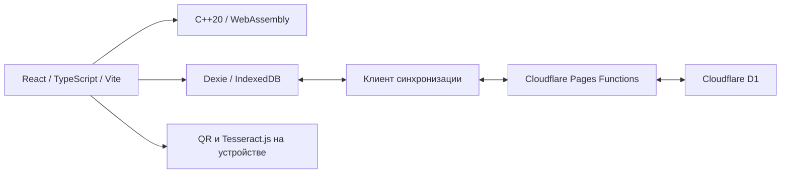

# Budget

Приложение для личного или общего бюджета двух участников. Работает как веб-приложение и PWA для iPhone.

- Недельные и месячные бюджеты с настраиваемыми границами, лимитами по категориям и прогнозом.
- Переносы лимитов между категориями внутри периода, история и аналитика операций.
- Расходы, учитываемые только в месячном бюджете, в том числе отдельные позиции чеков.
- Импорт кассовых чеков через фискальный QR, локальное OCR фотографии и ручную проверку позиций. Правила категоризации и опциональное округление чека.
- Локальное хранение, экспорт и импорт JSON, общий бюджет с офлайн-очередью и разрешением конфликтов.

## Архитектура



## Локальный запуск

Нужен Node.js 24 с npm. Для локального бюджета готовый WASM включён в исходники.

```sh
npm ci
npm run dev
```

Откройте адрес из вывода Vite. Для работы с локальным API и D1 выполните:

```sh
npm run build
npm run db:local
npm run dev:cloud
```

Откройте [127.0.0.1:8788](http://127.0.0.1:8788/). Для второго участника используйте отдельный профиль браузера.

## Сборка и проверки

```sh
npm run typecheck
npm run lint
npm test
npm run build
npm run test:cloud
npx playwright install chromium webkit
npm run test:e2e
npm run test:e2e:cloud
npm run test:e2e:receipt-media
```

Для пересборки WASM активируйте Emscripten и выполните `npm run build:wasm`. Нативной сборке нужны CMake и компилятор C++20. [Сборка и тесты ядра](docs/CPP_WASM.md).

## Публикация и ограничения

`npm run build` создаёт каталог `dist`. Cloudflare Pages загружает его через Wrangler вместе с Pages Functions. Для общего бюджета нужен D1 binding `DB`. Инструкции по миграциям, публикации и установке на iPhone приведены в [руководстве по развёртыванию](docs/DEPLOYMENT.md).

Прогноз зависит от истории расходов и границ периода. QR содержит фискальные реквизиты. Товарные позиции распознаются с фотографии или вводятся вручную. Перед сохранением пользователь проверяет распознанный чек. Первое открытие PWA и первая загрузка словарей OCR требуют сети. Сохранение общего бюджета между устройствами происходит после подключения к API.

## Документация

- [Архитектура](docs/ARCHITECTURE.md)
- [C++ и WebAssembly](docs/CPP_WASM.md)
- [Базы данных и миграции](docs/DATABASE.md)
- [Синхронизация](docs/SYNCHRONIZATION.md)
- [Чеки](docs/RECEIPTS.md)
- [Развёртывание](docs/DEPLOYMENT.md)
- [Безопасность](docs/SECURITY.md)
- [Тестирование](docs/TESTING.md)

## Скриншоты

[Бюджет в тёмной теме](docs/screenshots/demo/iphone-dark.png) · [Бюджет в светлой теме](docs/screenshots/demo/iphone-light.png). Оба снимка сделаны на демонстрационных данных.
