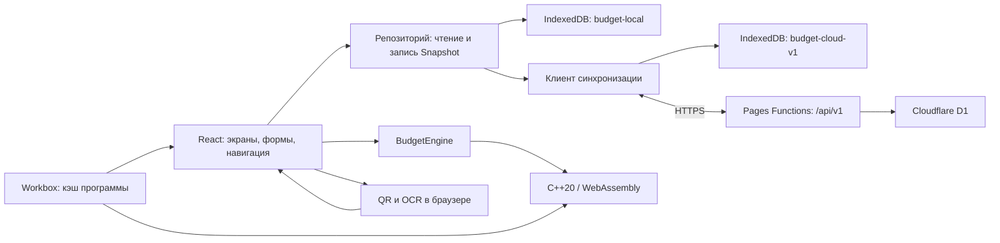
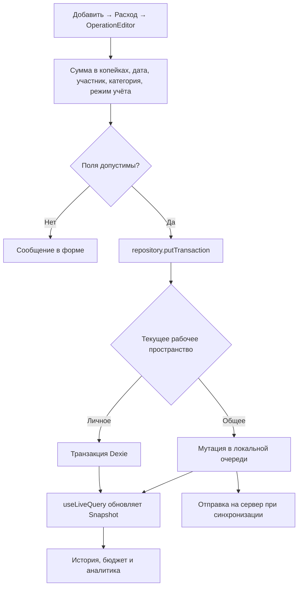
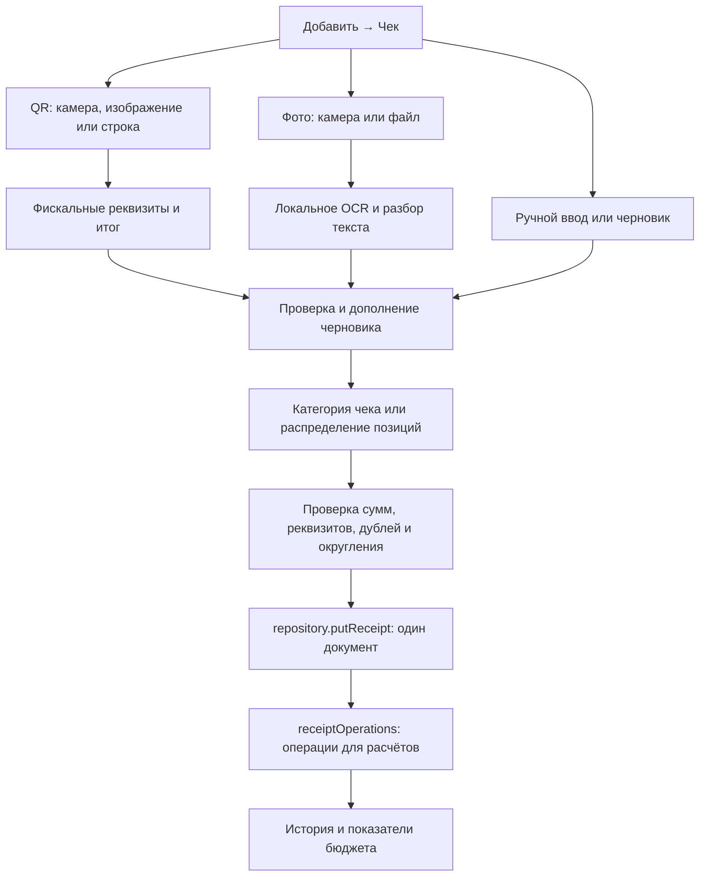
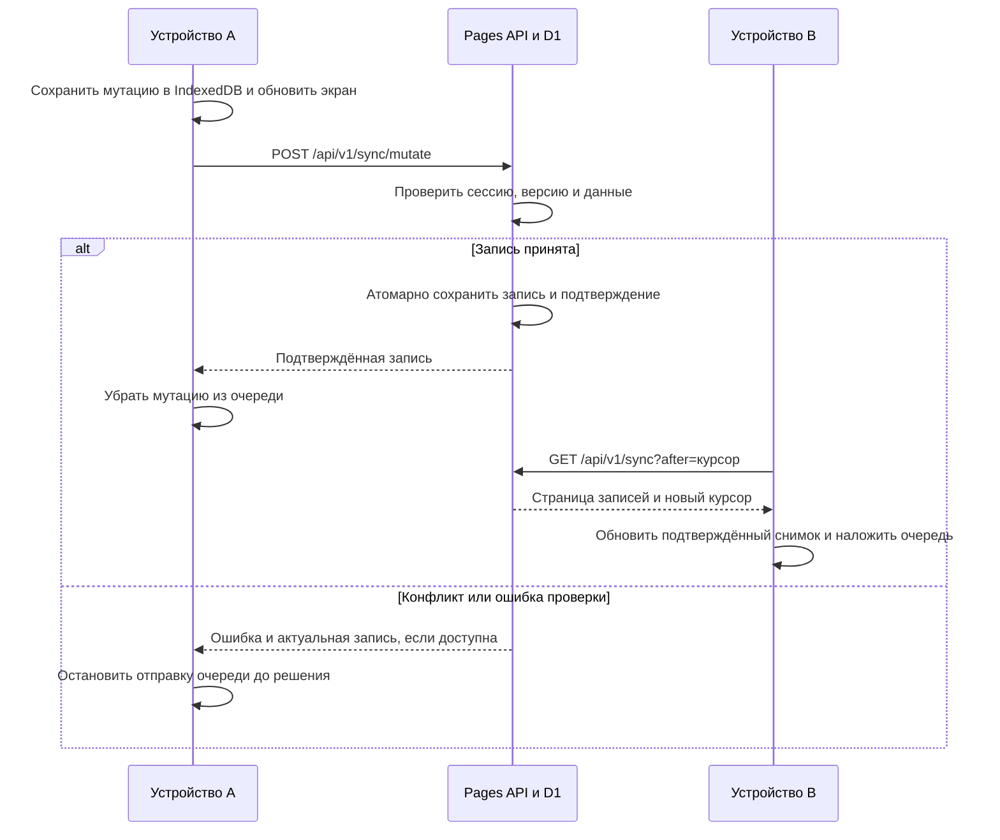
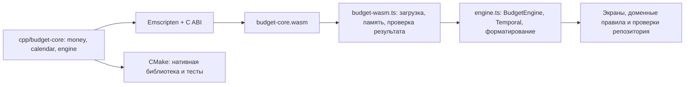
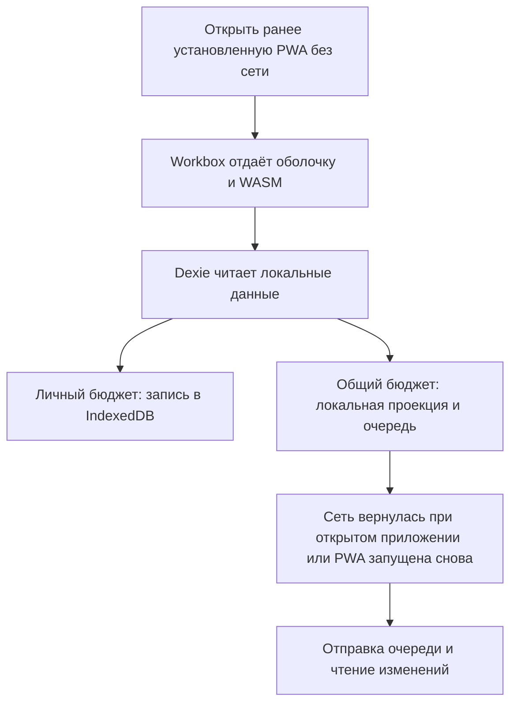

# Архитектура Budget

Budget — React-приложение, которое рассчитывает бюджет в браузере. Личный бюджет хранится в IndexedDB. Общий бюджет использует локальную копию с очередью изменений и синхронизирует её с Cloudflare D1 через API.

## Структура проекта

| Путь | Ответственность |
| --- | --- |
| [src/ui/](../src/ui/) | Экраны бюджета, истории, аналитики, категорий и настроек, формы операций и чеков |
| [src/domain/](../src/domain/) | Модели, календарь и форматирование, проверка и проекция чеков, переносы лимитов, адаптер WASM |
| [cpp/budget-core/](../cpp/budget-core/) | Расчёты в целых копейках, периоды, группировки и C ABI |
| [src/data/](../src/data/) | Репозиторий Dexie, миграции IndexedDB, проверка JSON-копий, демо-данные |
| [src/receipts/](../src/receipts/) | Декодирование QR, подготовка фото, локальное распознавание и разбор текста |
| [src/cloud/](../src/cloud/) | Протокол общего бюджета, проекция облачной копии, очередь, курсор и конфликты |
| [functions/api/v1/](../functions/api/v1/), [server/](../server/), [migrations/](../migrations/) | HTTP-маршрутизация, сессии, проверки записей, синхронизация и схема D1 |
| [src/infrastructure/](../src/infrastructure/), [vite.config.ts](../vite.config.ts) | Сборка приложения, кэш Workbox и обновление PWA |

## Запуск, навигация и выбор данных

1. [main.tsx](../src/main.tsx) показывает экран загрузки и ждёт `initializeBudgetEngine()`. При сбое загрузки WASM можно повторить инициализацию. После успеха монтируются `StorageBoundary` и `App`. Ошибка открытия хранилища приводит к экрану с предложением повторить загрузку страницы.
2. [App.tsx](../src/ui/App.tsx) подписывается на `repository.readWorkspace` через `useLiveQuery` и запускает облачную синхронизацию. Репозиторий читает локальный снимок для личного бюджета и при подготовке переноса (`staging`). При активном подключении `project()` строит снимок из подтверждённых записей и очереди. Пока данных нет, интерфейс показывает первичную настройку личного бюджета или загрузку общего. При истёкшей облачной сессии появляется экран восстановления доступа.
3. Навигация хранится в состоянии React. `page` выбирает экран, `kind` и `offset` задают период, `overlay` открывает форму или детали. Ссылка-приглашение обрабатывается отдельно. Форма привязана к `scope` рабочего пространства. При его смене форма скрывается, а репозиторий отклоняет запись с устаревшей областью. Подготовленный перенос блокирует запись, пока пользователь его завершает или отменяет подключение.
4. Команды записи проходят через `mutate`, который блокирует повторную отправку во время сохранения и показывает результат. Dexie уведомляет подписку после изменения, поэтому история, бюджет и аналитика обновляются из одного снимка.

## Ручной расход

[OperationEditor](../src/ui/Operations.tsx) создаёт запись с новым идентификатором или сохраняет прежний при редактировании. Репозиторий проверяет допустимость операции и доступность участника и категории. При редактировании он сверяет исходную запись с текущей. Сбой записи оставляет форму открытой и показывает ошибку. В общем бюджете автор фиксируется по текущей сессии при создании, а плательщик задаётся в форме. Удаление в общем бюджете отправляется как мутация с пустым значением. В личном бюджете запись удаляется из таблицы. Строки, созданные из чека, открывают сам чек для просмотра, исправления или удаления.

## Импорт чека

QR даёт фискальные реквизиты без товарных позиций. Фото и распознанный текст помогают заполнить черновик, который пользователь проверяет перед сохранением. Правила подсказывают категории позиций. При совпадении фискального ключа сохранение блокируется. Возможный нефискальный дубль требует подтверждения. Ошибка QR, OCR или проверки остаётся внутри процесса импорта, где можно исправить данные, повторить распознавание или заполнить чек вручную.

Фискальный итог и фактические суммы сохраняются. Если пользователь округлил учётную сумму, документ хранит её вместе с разницей. `receiptOperations()` вычисляет строки для бюджета из актуального чека, включая распределение по категориям и учёт округления. Таблица обычных операций эти строки не дублирует. При изменении или удалении чека проекция пересчитывается. Подробности описаны в [модели чека](receipt-data-model.md) и [описании OCR](receipt-ocr.md).

## Синхронизация двух устройств

Каждая мутация содержит уникальный ID и ожидаемую версию записи. Повтор после потери ответа использует тот же ID и тело. Курсор чтения продвигается после загрузки всех страниц. Подтверждение отдельной мутации обновляет запись без продвижения курсора. Удаления передаются отметками, поэтому устройство, пропустившее несколько изменений, увидит удаление при следующем чтении.

Конфликт версии или ошибка проверки блокирует дальнейшую отправку очереди. Пользователь может принять серверную запись или повторно отправить исправленную правку, если состояние допускает повтор. Правки, которые зависели от конфликтующей версии, могут потребовать отдельной проверки. Ошибки доступа 401 и 403 переводят приложение в режим восстановления. Очередь сохраняется в браузере. [Правила синхронизации](SYNCHRONIZATION.md) · [Модель доступа](SECURITY.md)

## C++ и WebAssembly

C++ рассчитывает границы периодов, итоги, проценты и разбивки расходов. TypeScript переводит момент времени в календарную дату в часовом поясе бюджета через Temporal. Периоды полуоткрытые, поэтому дата конца периода уже относится к следующему периоду. Деньги передаются через ABI как `BigInt` или поля `i64` в линейной памяти. Адаптер проверяет, что значение безопасно представить целым числом JavaScript, и освобождает буферы после вызова. Недельный учёт учитывает режим расхода, а фактические платежи показываются по дате независимо от режима. [Сборка и ABI](CPP_WASM.md)

## Офлайн и обновление PWA

Workbox предварительно кэширует сборку, включая финансовый WASM. Ресурсы OCR кэшируются по мере успешных запросов, поэтому первое распознавание может потребовать сети. Для путей `/api` и `/ocr` отключён возврат оболочки при навигации. Данные бюджета, черновики чеков и очередь находятся в IndexedDB.

Облачный клиент запускает синхронизацию при старте, событии `online`, возвращении в видимую вкладку, записи и ручном обновлении. Видимая вкладка опрашивает сервер каждые 20 секунд. После ошибок периодические повторы откладываются с увеличением паузы до двух минут. Закрытое приложение отправляет накопленные записи после следующего запуска. Когда новый Service Worker готов, `PwaUpdate` предлагает применить обновление и перезагружает страницу после смены контроллера.

## Совместимость данных

Dexie последовательно обновляет схему личного бюджета. Вторая версия переносит старые значки категорий в эмодзи с теми же ID, третья добавляет чеки, правила и черновики, четвёртая — переносы лимитов. Резервная копия проверяется перед транзакционной заменой таблиц. При отсутствии режима расхода старые записи учитываются как `weekly_and_monthly`. Общий бюджет использует отдельные последовательные миграции D1 и проверяет ожидаемые ревизии при переносе или восстановлении. [Миграции данных](data-migration.md)
