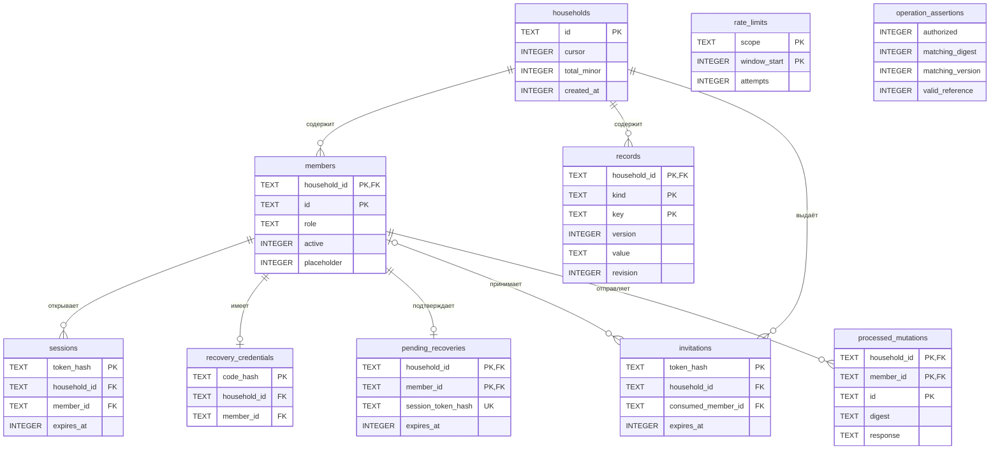

# Хранение данных

Budget использует три хранилища. Личный бюджет сохраняется в IndexedDB `budget-local`. Общий бюджет хранится в Cloudflare D1, а рабочая копия и очередь устройства — в IndexedDB `budget-cloud-v1`. Экспорт JSON переносит финансовые данные между устройствами и режимами.

## IndexedDB

| Таблица `budget-local` | Ключ | Содержимое |
| --- | --- | --- |
| `profile` | `household.id` | Название бюджета, общий лимит, настройки календаря и интерфейса |
| `categories` | `id` | Категории, лимиты, состояние архива и режим учёта |
| `members` | `id` | Участники и их оформление |
| `transactions` | `id` | Ручные доходы и расходы с индексами по дате, категории, участнику и типу |
| `receipts` | `id` | Документы чеков, позиции, фактический итог и параметры округления |
| `receiptRules` | `id` | Правила выбора категории по товару и, при наличии, магазину |
| `receiptDrafts` | `scope` | Черновики чеков по рабочей области |
| `limitTransfers` | `id` | Переносы лимита между категориями с привязкой к периоду |

В Dexie версия 2 преобразует старые иконки категорий в эмодзи, версия 3 добавляет таблицы чеков, а версия 4 добавляет переносы лимита. В базе `budget-cloud-v1` версии 1 таблица `connections` хранит одну запись с ключом `active`. В ней находятся область сессии, подтверждённые записи, курсор и состояние ожидающих операций.

## D1

Диаграмма показывает основные поля. Ссылки на участника составные и используют пару `(household_id, member_id)`. Таблица `operation_assertions` служит для проверок внутри транзакций записи. В `records` находятся JSON-документы типов `profile`, `category`, `transaction`, `member`, `receipt`, `receiptRule`, `limitTransfer`. Триггеры отражают изменения `members` в записях `member` и повышают курсор бюджета при добавлении или смене версии записи. Удаление сохраняет строку с увеличенной версией и `value = NULL`.

Связи с категориями внутри JSON проверяются сервером и триггерами D1. Представление `record_category_refs` разворачивает ссылки операций, чеков и правил. Триггер удаления категории проверяет также обе стороны сохранённых переносов лимита. Индекс `receipt_fiscal_identity` обеспечивает уникальность активного фискального чека в бюджете по `fn`, `i`, `fp`, `n`.

Суммы сохраняются в целых копейках. `households.total_minor` — контрольная сумма оборота. Триггеры учитывают суммы ручных операций и `budgetAmount` чеков с запасным значением `total` для прежних чеков. Переносы лимита перераспределяют бюджет категории в периоде, поэтому оборот при их сохранении не меняется. Операции по позициям и округлению выводятся из документа чека при чтении.

## Миграции и резервные копии

| D1 | Изменение |
| --- | --- |
| `0001_households.sql` | Базовая схема бюджета, доступ, записи и подтверждения мутаций |
| `0002_recovery_confirmation.sql` | Подтверждение замены кода восстановления |
| `0003_receipts.sql` | Чеки, правила категорий, фискальная уникальность и защита реквизитов |
| `0004_receipt_rounding.sql` | Учёт округлённой суммы и ссылки на её категорию |
| `0005_limit_transfers.sql` | Переносы лимитов и защита связанных категорий |

Миграции применяются по порядку. Перестроения `records` в миграциях 0003 и 0005 копируют версии и ревизии до восстановления триггеров. Локальный импорт разбирает JSON версий 1–3, облачный протокол переноса принимает версии 2–3. Снимок включает сохранённые чеки, но исключает вычисленные операции из чеков и черновики. [Миграция данных](data-migration.md) · [Модель данных чеков](receipt-data-model.md)
